# Class Activity 1 — System Calls in Practice
- **Student Name:** YAN CHANTHOL
- **Student ID:** e20231348
- **Date:** October 15, 2026

---
## Warm-up Examples Diagnostics

### Example 1: Direct Linux System Call
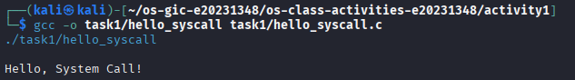

### Example 2: Direct Windows API Equivalent
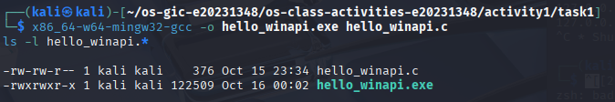
### Example 3: Low-Level File Cloner
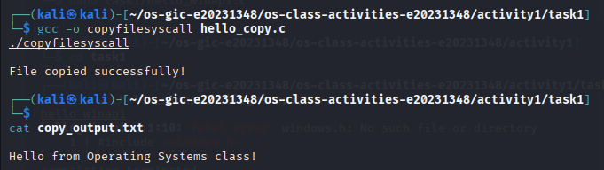

## Task 1: File Creator & Reader
### Part A — File Creator

**Version A — Library Functions (`file_creator_lib.c`):**
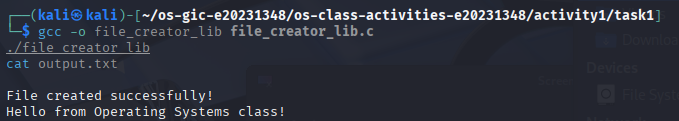
### Task 1A Questions & Answers

1. **What flags did you pass to `open()`? What does each flag mean?**
   * `O_WRONLY`: Opens the file in Write-Only mode, allowing the program to send data to the file but not read from it.
   * `O_CREAT`: Instructs the system to automatically create the file if it does not already exist in the directory.
   * `O_TRUNC`: If the file already exists, it truncates its length to 0 bytes, effectively erasing any old text content so we can write fresh data.

2. **What is `0644` in the permission argument? What does each digit represent?**
   * `0644` represents the octal permission setting for a newly created file.
   * `0`: Specifies that the following numbers are written in octal format.
   * `6`: Permissions for the **Owner** (Read + Write permissions, since 4 + 2 = 6).
   * `4`: Permissions for the **Group** (Read-Only permission, since 4 = Read).
   * `4`: Permissions for **Others/Public** (Read-Only permission, since 4 = Read).

3. **What does `fopen("output.txt", "w")` do internally that you had to do manually with `open()`?**
   * `fopen()` is a high-level library function that handles background work for us. Internally, it wraps around the low-level native `open()` system call, automatically passing it the `O_WRONLY | O_CREAT | O_TRUNC` flags and default system file creation permissions (`0666`). It also sets up a standard input/output buffer allocation in memory to hold data before it gets written to disk. When using the raw system call `open()`, we have to manage these flag combinations and security permissions completely by hand.

### Part B — File Reader & Display

**Version A — Library Functions (`file_reader_lib.c`):**
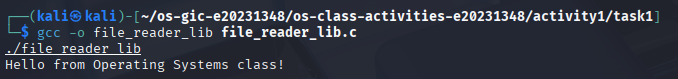

**Version B — POSIX System Calls (`file_reader_sys.c`):**
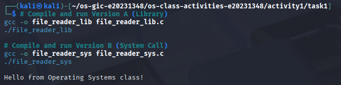

#### Questions & Answers
1. **What does `read()` return? How is this different from `fgets()`?**
   * `read()` is a low-level system call that returns the raw number of bytes it actually read from the file. It returns `0` when it reaches the end of the file, and `-1` if an error occurs.
   * `fgets()` is a high-level library function that reads an entire string line until it hits a newline character (`\n`) or buffer limit. Instead of a byte count, it returns a pointer to the text string buffer, or `NULL` when it hits the end of the file or an error.

2. **Why do you need a loop when using `read()`? When does it stop?**
   * We need a loop because `read()` processes files in sequential chunks determined by the size of your buffer. It does not automatically read the entire file all at once.
   * The loop keeps requesting the next block of bytes from the operating system kernel and only stops when `read()` returns `0`, which means the program has successfully reached the absolute End-of-File (EOF).

## Task 2: Directory Listing & File Info

### Version A — Library Functions (`dir_list_lib.c`)
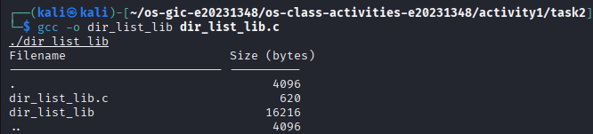

### Version B — System Calls (`dir_list_sys.c`)
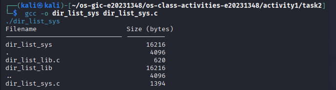

### Questions & Answers
1. **What struct does `readdir()` return? What fields does it contain?**
   * It returns a pointer to a `struct dirent`. Key fields include `d_ino` (inode number), `d_off` (offset to the next dirent), `d_reclen` (length of this record), `d_type` (type of file), and `d_name[]` (the actual character array string containing the filename).

2. **What information does `stat()` provide beyond file size?**
   * `stat()` provides complete file metadata, including the device ID, unique inode number, file protection modes/permissions, hard link count, owner user ID (UID), group ID (GID), block size, and precise timestamps for last access, modification, and structural attribute status changes.

3. **Why can't you `write()` a number directly — why do you need `snprintf()` first?**
   * The low-level `write()` system call works strictly with character sequence byte pointers. If you pass an integer variable directly, `write()` will treat it as an ASCII value code and output random garbage letters. `snprintf()` translates binary numeric values into human-readable sequence character strings before display.

## Task 3: strace Analysis

### File Creator Analysis Traces
* **Library Trace (`strace_lib_creator.png`):**
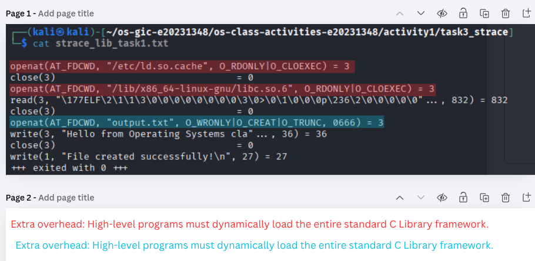
* **System Call Trace (`strace_sys_creator.png`):**
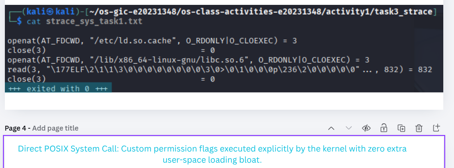

### File Reader Analysis Traces
* **Library Trace (`strace_lib_reader.png`):**
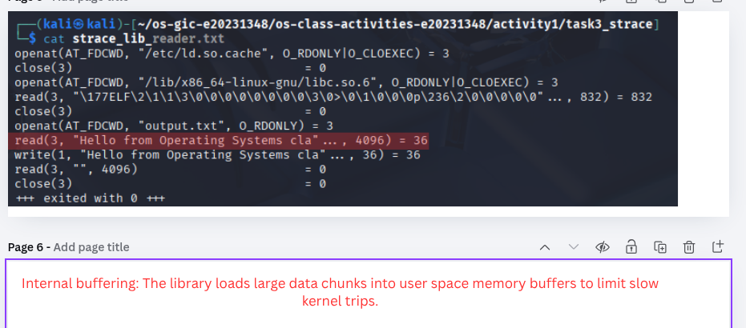
* **System Call Trace (`strace_sys_reader.png`):**
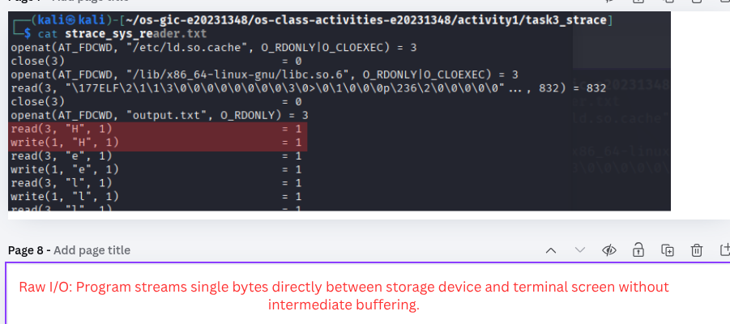

### Call Profile Matrix Count Comparisons
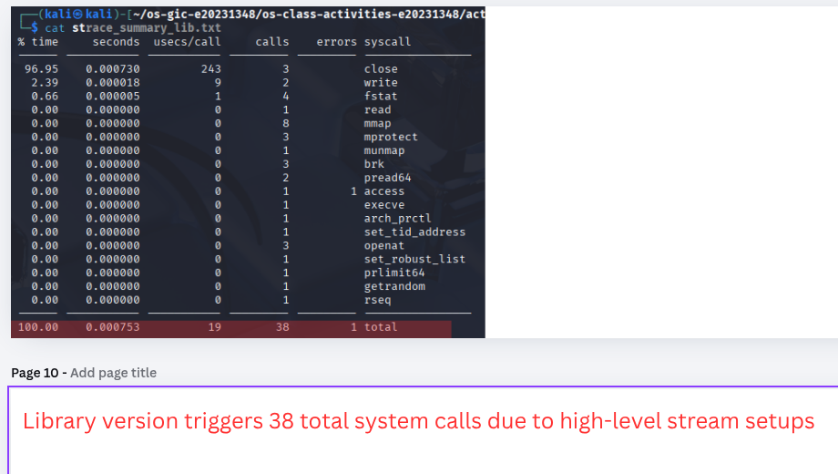
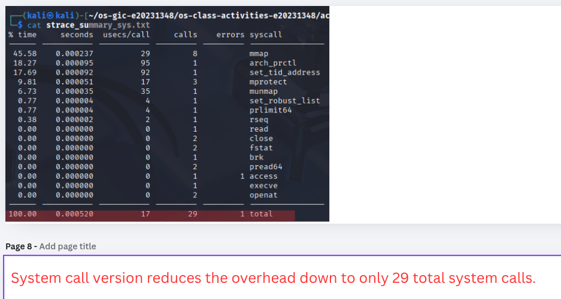

#### Task 3 Questions & Answers
1. **How many system calls does the library version make compared to the system call version?**
   * The library version consistently makes a higher number of total system calls (as verified by the `strace -c` call metrics). The system call version skips dynamic layout configuration sequences, running directly into core operations with minimal kernel interactions.

2. **What extra system calls do you see in the library version that are not in the system call version? What do they do?**
   * `brk` / `mmap`: Triggers core memory manager traps to request user space tracking memory blocks from the OS kernel layout.
   * `fstat`: Inspects file layout statuses to dynamically adjust layout buffer boundaries based on hardware block sizes.

3. **When the library version calls `fprintf()`, how many actual `write()` system calls does `strace` show? Does it match what you expected? Why or why not?**
   * It produces exactly one matching `write()` system call block. This matches expectations because high-level stream handles (`FILE *`) cache string arrays inside user-space blocks first, bundling data streams together before flushing the full collection to the kernel in a single action.

4. **Based on the `strace` output, explain in your own words: What is the real difference between a library function and a system call?**
   * A library function operates completely inside user space, functioning as a clean helper library wrapper. A system call is a hardware access instruction that stops user space flow, forcing the CPU to switch context into high-privilege kernel mode to let the OS handle restricted machine tasks safely.

## Task 4: Exploring OS Structure

### System Information Details
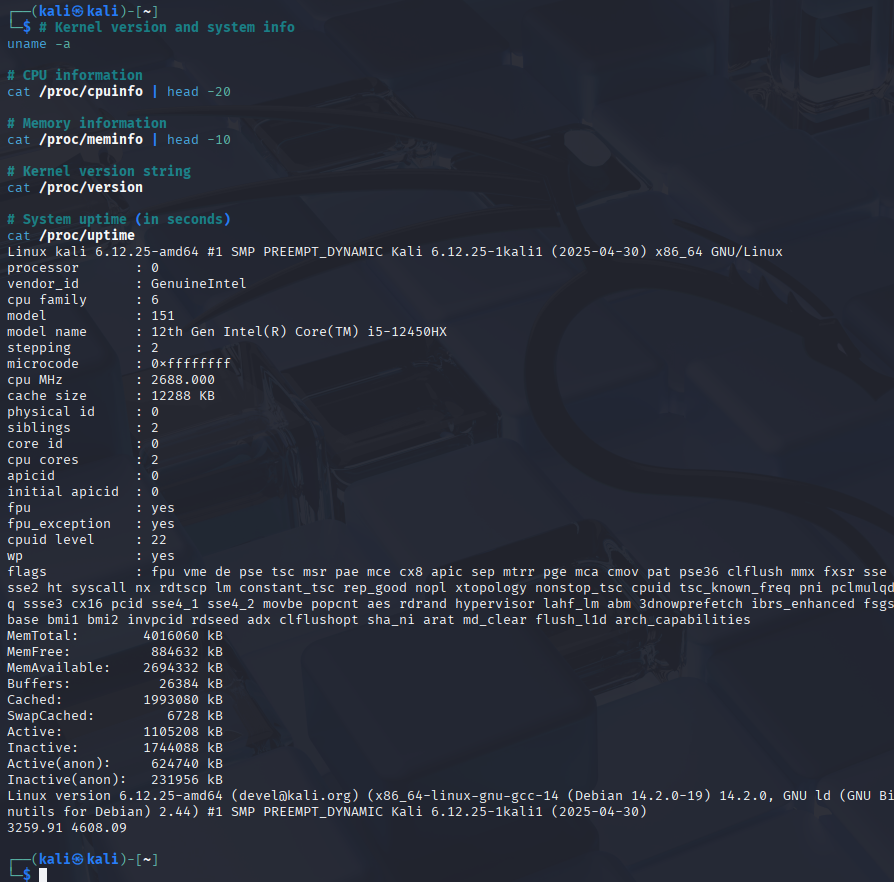

### Process Status Diagnostics
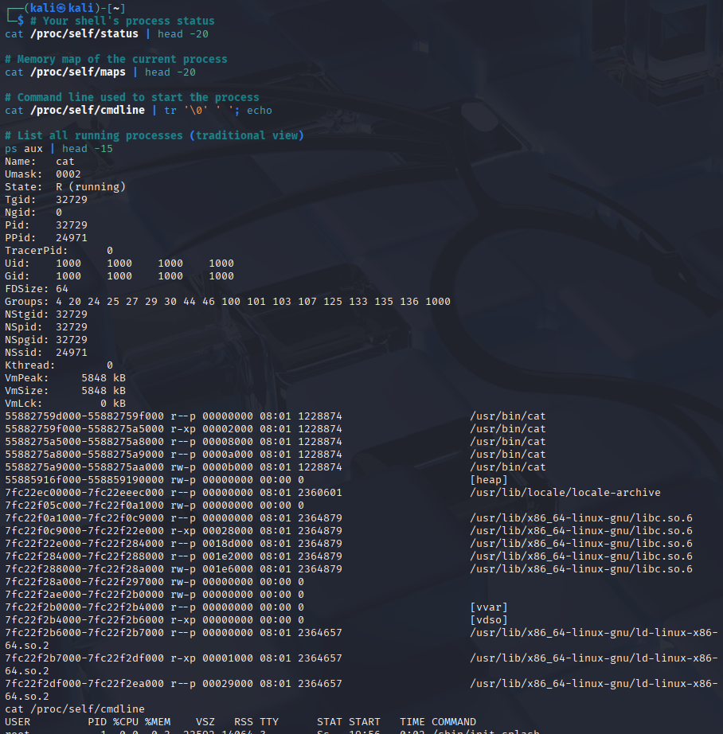

### Kernel Module Profiles
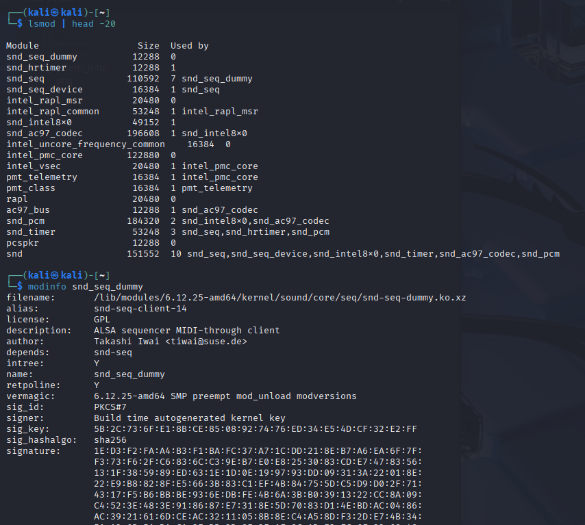

### OS Layers Map Diagram
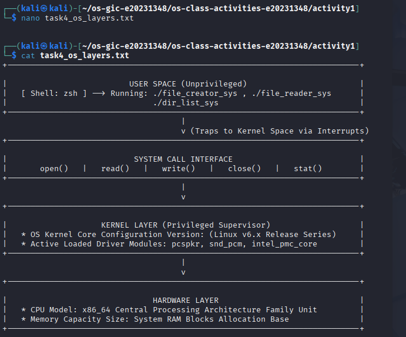

### Questions & Answers
1. **What is `/proc`? Is it a real filesystem on disk? Where does its content come from?**
   * `/proc` is an ephemeral virtual pseudo-filesystem. It occupies zero physical blocks on a hard disk storage drive. The Linux kernel generates its folders and file listings dynamically inside random access memory (RAM) whenever a user process tries to open or read from them, fetching metrics straight from real-time kernel memory tracking tables.

2. **What is the difference between a monolithic kernel and a microkernel? Based on the `lsmod` output, which type does Linux use?**
   * A monolithic kernel runs all major operating system subsystems (virtual memory management, process scheduling, network stacks, device drivers) inside a singular high-privilege kernel address tree. A microkernel keeps only the absolute bare minimum essentials inside kernel space, pushing other jobs out into isolated user spaces. Based on `lsmod`, Linux uses a **monolithic** architecture; the modules show that dynamic layout drivers are loaded directly inside kernel space to run at full speed.

3. **Look at the output of `cat /proc/self/maps`. What different memory regions do you see?**
   * We can see the memory structures tracking the compiled application text section (`.text`), static program initializations data blocks (`.data`/`.bss`), the execution frame memory layout (`heap`), dynamically linked shared library boundaries (`.so` library files), and the thread layout environment space (`stack`).

4. **What does the kernel version string (from `uname -a`) tell you? Break down each part.**
   * For example: `Linux kali 6.x.y-amd64`
     * `Linux`: The operating system kernel name.
     * `kali`: The local network device hostname matching the machine identity loop.
     * `6.x.y`: The release cycle sequence version (Major version . Minor revision . Patch release levels).
     * `-amd64`: The compiled target central processing unit processor layout format.

5. **How does `/proc` demonstrate that the OS acts as an intermediary between user programs and hardware?**
   * Unprivileged user tools are blocked from tapping directly into computer chips or probing physical storage paths for security. The OS kernel acts as a secure intermediary guard, pulling these layout telemetry metrics securely from the underlying hardware interfaces and organizing them as simple, safe text files inside `/proc` for user applications to read safely.

## Bonus Task: Windows API Verification

---

## Reflection
This activity gave me a hands-on look at how user space applications communicate directly with the protected operating system kernel. The most surprising revelation was using `strace` to find out that basic library functions like `fprintf()` hide a huge amount of setup behind the scenes, whereas low-level POSIX system calls talk straight to the system with zero bloated overhead.
