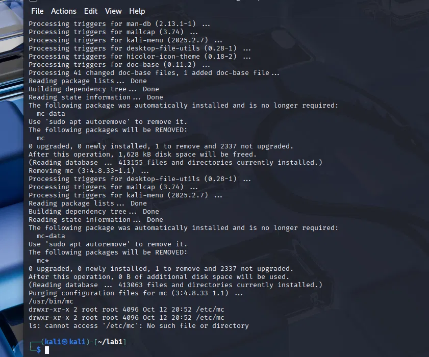
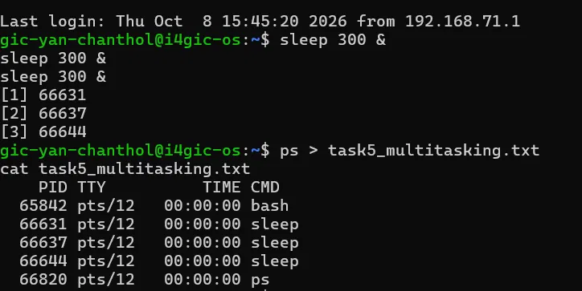
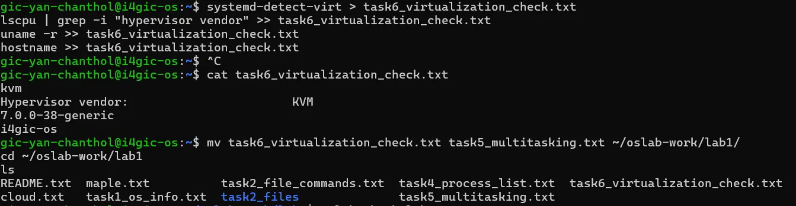

# OS Lab 1 Submission

- **Student Name:** YAN CHANTHOL
- **Student ID:** e20231348
- **Ubuntu username on the server:** gic-yan-chanthol
- **My values** (`oslab values lab1`): file1 = cloud, file2 = maple, count = 3

---

## Task 1: Operating System Identification

The kernel version is 7.0.0-38-generic. The distribution is Ubuntu 26.04 (26.04.1 LTS, codename resolute).

---

## Task 2: Essential Linux File and Directory Commands

I made a folder, created cloud.txt and maple.txt, wrote a line in each, copied the first file, renamed the second to maple_renamed.txt, and deleted the copy. The last `ls` showed cloud.txt and maple_renamed.txt.

---

## Task 3: Package Management Using APT

(Write this after you do Task 3.)

---

## Task 4: Programs vs Processes

I ran `sleep 30 &` and listed it with `ps`. A program is a file on the disk (/usr/bin/sleep). A process is a program that is running.
- Before: `which sleep` showed /usr/bin/sleep, but there was no sleep process.
- During: `ps` showed a sleep process.
- After: the process was gone, but /usr/bin/sleep was still on the disk.

---

## Task 5: Multitasking

I started 3 `sleep 300 &` processes. `ps` showed 3 sleep lines. This shows that several processes exist at the same time. It does not show how the processor is shared, because sleep only waits and uses no processor.

---

## Task 6: Virtualization and Hypervisor Detection

The first line was `kvm`, and the hypervisor vendor was KVM. So the system is a virtual machine, not physical hardware.

